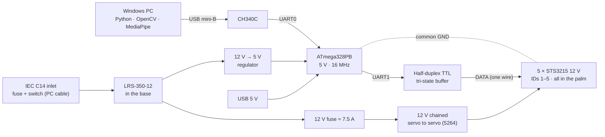
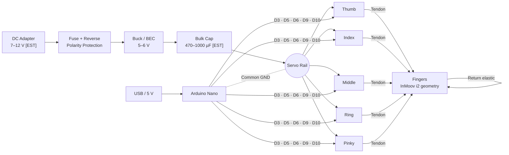

<div align="center">

# 🤖 HAEBOT Hand i2 — Version 1

**5-finger, independently actuated, tendon-driven robotic hand**
*InMoov Hand i2 기반 · Feetech STS3215 서보 x5 (손바닥) · ATmega328PB · 가위바위보 시연*


**지니에듀테크(주) · Genie EduTech Co., Ltd. — Busan, Korea**

</div>

---

## 📌 Overview

HAEBOT Hand i2 V1 is a 3D-printed robotic hand derived from the open-source **[InMoov Hand i2](https://inmoov.fr/hand-i2/)** by Gael Langevin.
Version 1 re-engineers the servo mounting for the **EMAX ES08MA II** micro servos we already own, drives **all five fingers independently** with tendons and return elastics, and targets a repeatable **Rock / Paper / Scissors** demonstration.

> 🔄 **Current design — Prototype A, updated 2026-11-26.** The hand uses **5 x Feetech STS3215 (ST-3215-C018, 12 V) smart servos, all 5 in the palm** (InMoov i2 palm parts scaled 1.28x), one per finger, on a half-duplex TTL bus from a custom **ATmega328PB** board. The 100 x 60 mm board and the **Mean Well LRS-350-12 PSU live in the base**, fed by a PC-style IEC C14 power cable; the servos share a **chained 12 V supply** (user's circuit). CAD: [`cad/prototype/A_servos_in_palm/`](cad/prototype/A_servos_in_palm/). Electronics: [`electronics/version_2/`](electronics/version_2/).

> ⚠️ **V1 status: PROTOTYPE CAD GENERATED, NOT YET PRINTED.** The ES08MA II servo adapter, pulley, fit-test seat and desk stand exist as STEP + STL and were checked digitally against the official WristLarge (0 mm³ overlap). **No physical fit, torque, current-draw, or endurance results exist yet.**

### 🖨️ Start here → [`cad/prototype/A_servos_in_palm/`](cad/prototype/A_servos_in_palm/) — print list, print settings, fasteners, fit checks, electrical notes

## 🎯 V1 Goals

| # | Goal | Acceptance |
|---|---|---|
| 1 | 5 fingers, each with its own servo | T-05 independence test |
| 2 | Rock ✊ / Paper ✋ / Scissors ✌ gestures | T-06 gesture test (N reps) |
| 3 | Reproducible, documented engineering repo | Another builder can print, wire, and calibrate from the docs |
| 4 | Education-ready | Usable in physical-AI / vibe-coding courses |

## 🧩 System Architecture — current (Prototype A, 2026-11-26)



Power layout is the user's decision (chained 12 V, PSU in the base). Safety notes for it (12 V fuse, firmware torque limits, inlet fuse, protective earth) are in the [Prototype A README](cad/prototype/A_servos_in_palm/README.md#electrical-users-design--electronics-is-owned-by-the-user-notes-only-nothing-redesigned). See also [`electronics/version_2/README.md`](electronics/version_2/README.md).

## 🧩 System Architecture — V1 (superseded)



| Subsystem | V1 Design | Status |
|---|---|---|
| Fingers | Official i2 fingers printed as-is; Hall sensors & magnets simply not installed, silicone-tip mould not printed | `READY TO PRINT` |
| Actuation | Tendon flexion + elastic extension | `PLANNED` |
| Servos | 5 × EMAX ES08MA II **in the palm** (InMoov's official small-servo option) | `SUPERSEDED` — now 5 × STS3215: 3 palm + 2 forearm |
| Servo seats | 5 × `02_ServoAdapter_ES08MA-II` dropped into the **unmodified** official `i2_WristLargeV2`; shaft on the original servo axis | `SUPERSEDED` — two-servo forearm tray generated; upper-hand mounts are separate |
| Pulley | `03_Pulley_ES08MA-II`, Ø17 × 10, keyed to the stock ES08MA horn | `SUPERSEDED` — STS3215 horn/pulley interface requires physical horn measurement |
| Stand | `10_DeskStand` holds the hand upright by its wrist prongs (M8 bolt) — no forearm in the prototype | `GENERATED` |
| MCU | Custom ATmega328PB board, USB mini-B for data (Arduino Nano in V1) | `PLANNED` |
| Power | 12 V DC jack may feed only the confirmed 12 V servo variant; use a correctly sized 7.4 V regulator for the low-voltage variant. Logic gets 5 V from USB or the on-board regulator; all grounds common | `PLANNED` |
| Sensors | **None in V1** (no Hall sensors, no magnets) | By design |

## 📂 Repository Structure

```
robot-hand/
├── README.md
├── dona_univ_robot_hand_2026-11-13_Sanjev_attribution.md         # InMoov / third-party credits
├── LICENSE.md             # licensing notice (non-commercial)
├── docs/
│   └── 동아대_robot_hand_2026-11-11_산지브_해봇핸드i2_프로젝트계획서.docx   # Project plan (management report)
├── prompts/
│   └── 동아대_robot_hand_2026-11-11_산지브_해봇핸드i2_구현프롬프트.md        # Claude implementation brief
├── cad/
│   ├── README.md          # which folder is what
│   ├── prototype/A_servos_in_palm/   # ⭐ Prototype A: print/, reference/, reports/, images/, scripts/
│   ├── prototype/B_servos_in_forearm/ # backup, not started
│   └── original/          # unmodified InMoov Hand i2 + forearm servo bed files (for the later big-servo build)
├── electronics/
│   ├── version_1/         # archived: Pi 5 stacked controller concept (power budget, BOM, renders, STEP)
│   └── version_2/         # ATmega328PB + STS3215 bus plan; verify servo voltage suffix
├── firmware/              # Arduino sketch                                    — coming
├── bom/                   # Bill of materials                                 — coming
└── tests/                 # Test record templates                             — coming
```

## 🔌 Electronics versions

| Version | Plan | Where |
|---|---|---|
| 1 | Pi 5 stacked controller, PCA9685, 6 x MG996R, TMC2209 (archived) | [`electronics/version_1/`](electronics/version_1/) |
| 2 | Custom board (CH340C, ATmega328PB, half-duplex TTL servo bus) driving 5 x Feetech STS3215, one per finger, all 5 in the palm (Prototype A); PSU + board in the base; USB mini-B carries data; the 12 V input may feed only the confirmed 12 V servo variant | [`electronics/version_2/`](electronics/version_2/) |

Version 2 is pre-schematic. See its README for the open items.

## 📄 Documents

| Document | Description |
|---|---|
| [📘 Project Plan (DOCX)](docs/동아대_robot_hand_2026-11-11_산지브_해봇핸드i2_프로젝트계획서.docx) | Objective, architecture, scope, BOM, stages, milestones, risks, acceptance tests, approval sheet |
| [🧠 Implementation Prompt (MD)](prompts/동아대_robot_hand_2026-11-11_산지브_해봇핸드i2_구현프롬프트.md) | Copy-ready brief for Claude to build the full engineering repo with strict no-fabrication rules |

## 🗓️ Roadmap

| Stage | Weeks `[EST]` | Work | Milestone |
|---|---|---|---|
| S1 | 1 | Source review & license audit | M1 — audit approved |
| S2 | 1–2 | Caliper measurement of ES08MA II, per-servo stall/peak current | M2 — `parameters.yaml` filled, regulator rating fixed |
| S3 | 2–3 | Servo cradle, spool, palm layout, fit coupon | M3 — T-01 pass |
| S4 | 3–4 | KiCad schematic + ERC, firmware & calibration mode | M4 — ERC clean, single servo runs |
| S5 | 4–5 | Full print & tendon assembly | M5 — T-04/T-05 pass |
| S6 | 5–6 | Acceptance tests & documentation | M6 — R/P/S demo recorded |

- [ ] S1 Source review & license audit
- [ ] S2 Measurement & power characterization
- [~] S3 Mechanical design — CAD generated; waiting on fit coupon + caliper data
- [ ] S4 Electronics & firmware
- [ ] S5 Print & assembly
- [ ] S6 Test & documentation

## 🧪 Acceptance Tests (planned — no results yet)

| ID | Test | Pass criterion |
|---|---|---|
| T-01 | Servo fit | Seats without force; play within tolerance |
| T-02 | Power rail | Stays within 5–6 V under 5-servo load |
| T-03 | Stall / peak current | Recorded per servo → regulator sized with ≥ 1.5× margin `[EST]` |
| T-04 | Finger range of motion | Full flex/extend, no tendon slip or binding |
| T-05 | Independence | No unintended motion of other fingers |
| T-06 | Gestures | R/P/S recognisable over N reps |
| T-07 | Thermal | Case temperature recorded, no shutdown |
| T-08 | Endurance | Failures logged; no claims beyond recorded N |

## 🏷️ Data Integrity Convention

Every number in this project carries one tag:

| Tag | Meaning |
|---|---|
| `[SRC]` | From a cited source |
| `[DS]` | Manufacturer datasheet nominal — still to be confirmed |
| `[EST]` | Engineering estimate, with range |
| `[TBM]` | To be measured on the physical part |

Files are labelled `PLANNED → DESIGNED → GENERATED → PRINTED → ASSEMBLED → TESTED`. Fusion 360 `.f3d` files are published **only** if exported from real Fusion 360.

## ⚡ Safety

- **Mains in the base (LRS-350-12):** inlet fuse T4A slow-blow, protective earth inlet → PSU FG, terminal cover, PSU switch on 230 V; mains wiring by a qualified person; unplug before opening the base.
- **12 V servo chain:** fuse ≈ 7.5 A at the PSU output and set torque/current limits in the firmware — the PSU (29 A) can overheat the 5264 connectors.
- **Never power the servos from the board 5 V.**
- Always connect **common ground** between the servo supply and the Nano.
- Keep fingers clear during calibration; servos can pinch.

## 📜 License & Attribution

- Mechanical design is derived from **InMoov Hand i2 © Gael Langevin**, released under a Creative Commons **Non-Commercial** license (exact version to be confirmed on [inmoov.fr](https://inmoov.fr/hand-i2/)).
- Unmodified InMoov STL files are kept in `cad/original/` for our internal build (InMoov is **CC BY-NC 3.0** — attribution required, non-commercial only). **This repository is intended to be private.**
- Any future part derived from an InMoov file inherits CC BY-NC 3.0. **No commercial use or sale** of InMoov-derived parts without the author's permission.
- See [dona_univ_robot_hand_2026-11-13_Sanjev_attribution.md](dona_univ_robot_hand_2026-11-13_Sanjev_attribution.md) and [LICENSE.md](LICENSE.md).

## 🔗 References

1. **PRIMARY vision-to-hand** — [Bolofofopt/HumanoidRoboticArmVision](https://github.com/Bolofofopt/HumanoidRoboticArmVision) (architecture reference; see [docs/dona_univ_robot_hand_2026-11-13_Sanjev_references.md](docs/dona_univ_robot_hand_2026-11-13_Sanjev_references.md))
2. InMoov Hand i2 — <https://inmoov.fr/hand-i2/>
3. geigermartin/prostheticHand — <https://github.com/geigermartin/prostheticHand>
4. Reference video — <https://www.youtube.com/watch?v=7KV5489rL3c>

---

<div align="center">

**지니에듀테크(주) Genie EduTech** · No.1 Education Technology Company
[jcodeedu.com](http://jcodeedu.com)

</div>
