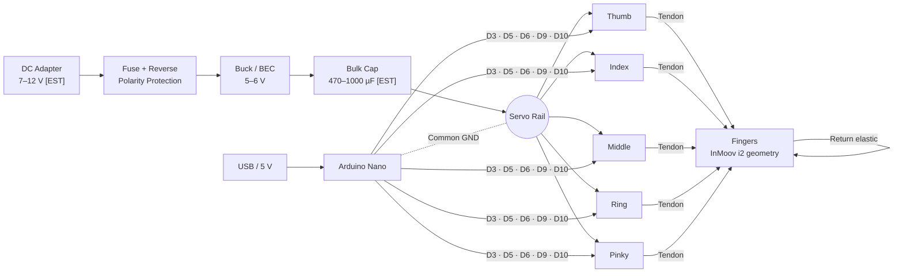

<div align="center">

# 🤖 HAEBOT Hand i2 — Version 1

**5-finger, independently actuated, tendon-driven robotic hand**
*InMoov Hand i2 기반 · EMAX ES08MA II 서보 · Arduino Nano · 가위바위보 시연*


**지니에듀테크(주) · Genie EduTech Co., Ltd. — Busan, Korea**

</div>

---

## 📌 Overview

HAEBOT Hand i2 V1 is a 3D-printed robotic hand derived from the open-source **[InMoov Hand i2](https://inmoov.fr/hand-i2/)** by Gael Langevin.
Version 1 re-engineers the servo mounting for the **EMAX ES08MA II** micro servos we already own, drives **all five fingers independently** with tendons and return elastics, and targets a repeatable **Rock / Paper / Scissors** demonstration.

> ⚠️ **Project status: CAD GENERATED, NOT YET PRINTED.** The pulley, fit coupon and one-finger test rig exist as STEP + STL, but are built from seller-nominal / estimated ES08MA II dimensions. **No physical fit, torque, current-draw, or endurance results exist yet.** Electronics and firmware come next.

### 🖨️ Start here → [`cad/README.md`](cad/README.md) — what to print, what not to print, in which order.

## 🎯 V1 Goals

| # | Goal | Acceptance |
|---|---|---|
| 1 | 5 fingers, each with its own servo | T-05 independence test |
| 2 | Rock ✊ / Paper ✋ / Scissors ✌ gestures | T-06 gesture test (N reps) |
| 3 | Reproducible, documented engineering repo | Another builder can print, wire, and calibrate from the docs |
| 4 | Education-ready | Usable in physical-AI / vibe-coding courses |

## 🧩 System Architecture



| Subsystem | V1 Design | Status |
|---|---|---|
| Fingers | Official i2 fingers printed as-is; Hall sensors & magnets simply not installed, silicone-tip mould not printed | `READY TO PRINT` |
| Actuation | Tendon flexion + elastic extension | `PLANNED` |
| Servos | 5 × EMAX ES08MA II in the InMoov forearm servo bed (official location) | `OWNED` — dims `[TBM]` |
| Forearm servo bed | Official RobServoBedV6 + 5 × `HB_F01` adapter plates for ES08MA II (shaft at original position/height) | `GENERATED` |
| Pulley | New Ø17 × 10 pulley keyed to the stock ES08MA horn | `GENERATED` |
| One-finger rig | Clevis + tendon/PTFE tower + servo seat for testing a single finger | `GENERATED` |
| MCU | Arduino Nano (ATmega328P) | `PLANNED` |
| Power | Separate regulated 5–6 V servo rail, **common ground** | `PLANNED` |
| Sensors | **None in V1** (no Hall sensors, no magnets) | By design |

## 📂 Repository Structure

```
robot-hand/
├── README.md
├── ATTRIBUTION.md         # InMoov / third-party credits
├── LICENSE.md             # licensing notice (non-commercial)
├── docs/
│   └── 해봇핸드i2_프로젝트계획서_261111.docx   # Project plan (management report)
├── prompts/
│   └── 해봇핸드i2_구현프롬프트_261111.md        # Claude implementation brief
├── cad/
│   ├── README.md          # ⭐ print guide: print / do-not-print / order
│   ├── parameters.yaml    # all dimensions, tagged SRC/DS/EST/TBM
│   ├── 01_official_inmoov_i2/   print/ + do_not_print/  (unmodified InMoov STL)
│   ├── 02_haebot_modified/      step/ + stl/  (our parts)
│   ├── 01_official_inmoov_forearm/  RobServoBedV6 (unmodified)
│   ├── 03_one_finger_test/      step/ + stl/
│   ├── 04_forearm_servo_bed/    step/ + stl/  (ES08MA II adapter plate)
│   └── src/               # CadQuery / mesh scripts that regenerate everything
├── electronics/           # KiCad schematic & project                         — coming
├── firmware/              # Arduino sketch                                    — coming
├── bom/                   # Bill of materials                                 — coming
└── tests/                 # Test record templates                             — coming
```

## 📄 Documents

| Document | Description |
|---|---|
| [📘 Project Plan (DOCX)](docs/해봇핸드i2_프로젝트계획서_261111.docx) | Objective, architecture, scope, BOM, stages, milestones, risks, acceptance tests, approval sheet |
| [🧠 Implementation Prompt (MD)](prompts/해봇핸드i2_구현프롬프트_261111.md) | Copy-ready brief for Claude to build the full engineering repo with strict no-fabrication rules |

## 🗓️ Roadmap

| Stage | Weeks `[EST]` | Work | Milestone |
|---|---|---|---|
| S1 | 1 | Source review & license audit | M1 — audit approved |
| S2 | 1–2 | Caliper measurement of ES08MA II, per-servo stall/peak current | M2 — `parameters.yaml` filled, regulator rating fixed |
| S3 | 2–3 | Servo cradle, spool, palm layout, fit coupon | M3 — T-01 pass |
| S4 | 3–4 | KiCad schematic + ERC, firmware & calibration mode | M4 — ERC clean, single servo runs |
| S5 | 4–5 | Full print & tendon assembly | M5 — T-04/T-05 pass |
| S6 | 5–6 | Acceptance tests & documentation | M6 — R/P/S demo recorded |

- [ ] S1 Source review & license audit
- [ ] S2 Measurement & power characterization
- [~] S3 Mechanical design — CAD generated; waiting on fit coupon + caliper data
- [ ] S4 Electronics & firmware
- [ ] S5 Print & assembly
- [ ] S6 Test & documentation

## 🧪 Acceptance Tests (planned — no results yet)

| ID | Test | Pass criterion |
|---|---|---|
| T-01 | Servo fit | Seats without force; play within tolerance |
| T-02 | Power rail | Stays within 5–6 V under 5-servo load |
| T-03 | Stall / peak current | Recorded per servo → regulator sized with ≥ 1.5× margin `[EST]` |
| T-04 | Finger range of motion | Full flex/extend, no tendon slip or binding |
| T-05 | Independence | No unintended motion of other fingers |
| T-06 | Gestures | R/P/S recognisable over N reps |
| T-07 | Thermal | Case temperature recorded, no shutdown |
| T-08 | Endurance | Failures logged; no claims beyond recorded N |

## 🏷️ Data Integrity Convention

Every number in this project carries one tag:

| Tag | Meaning |
|---|---|
| `[SRC]` | From a cited source |
| `[DS]` | Manufacturer datasheet nominal — still to be confirmed |
| `[EST]` | Engineering estimate, with range |
| `[TBM]` | To be measured on the physical part |

Files are labelled `PLANNED → DESIGNED → GENERATED → PRINTED → ASSEMBLED → TESTED`. Fusion 360 `.f3d` files are published **only** if exported from real Fusion 360.

## ⚡ Safety

- **Never power the servos from the Arduino Nano 5 V pin.** Use the separate regulated rail.
- Always connect **common ground** between the servo supply and the Nano.
- Keep fingers clear during calibration; servos can pinch.

## 📜 License & Attribution

- Mechanical design is derived from **InMoov Hand i2 © Gael Langevin**, released under a Creative Commons **Non-Commercial** license (exact version to be confirmed on [inmoov.fr](https://inmoov.fr/hand-i2/)).
- Unmodified InMoov STL files are kept in `cad/01_official_inmoov_i2/` for our internal build (InMoov is **CC BY-NC 3.0** — attribution required, non-commercial only). **This repository is intended to be private.**
- Any future part derived from an InMoov file inherits CC BY-NC 3.0. **No commercial use or sale** of InMoov-derived parts without the author's permission.
- See [ATTRIBUTION.md](ATTRIBUTION.md) and [LICENSE.md](LICENSE.md).

## 🔗 References

1. **PRIMARY vision-to-hand** — [Bolofofopt/HumanoidRoboticArmVision](https://github.com/Bolofofopt/HumanoidRoboticArmVision) (architecture reference; see [docs/references.md](docs/references.md))
2. InMoov Hand i2 — <https://inmoov.fr/hand-i2/>
3. geigermartin/prostheticHand — <https://github.com/geigermartin/prostheticHand>
4. Reference video — <https://www.youtube.com/watch?v=7KV5489rL3c>

---

<div align="center">

**지니에듀테크(주) Genie EduTech** · No.1 Education Technology Company
[jcodeedu.com](http://jcodeedu.com)

</div>
