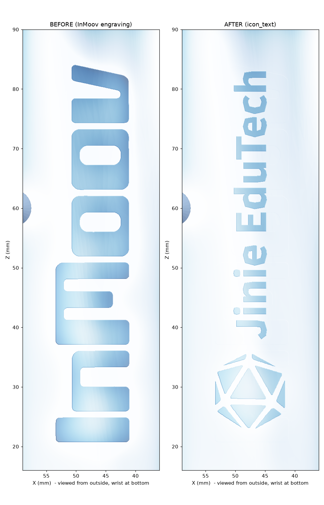

# Jinie EduTech branded Hand Cover

Replacement for official `i2_HandCoverV1` (kept unmodified in `cad/01_official_inmoov_i2/print/`).
The engraved "InMoov" is filled flush and replaced with the Jinie EduTech icon plus
"Jinie EduTech", engraved 1.0 mm, 60 × 11.7 mm, reading wrist → fingers like the original.

The official cover is InMoov-derived (CC BY-NC 3.0). The logo artwork is the
지니에듀테크 / Jinie EduTech company logo (our own). "Co., Ltd." and the tagline were
left off: they would be ~2 mm tall on this 12 mm strip and would not print cleanly.
Icon white ribs were widened to 0.8 mm for FDM.

> Status: GENERATED — not yet printed. Lettering is Noto Sans CJK Bold, so it may
> differ slightly from the official wordmark. Swap in a vector logo (SVG/AI) later if needed.



## Print these

| File | Notes |
|---|---|
| `stl/JE_HandCoverV1_JinieLogo.stl` | **Primary** — icon + "Jinie EduTech" |
| `stl/JE_HandCoverV1_JinieIconOnly.stl` | Alternative — icon only |
| `stl/JE_HandCoverV1_NoLogo.stl` | Blank cover (old engraving removed, nothing added) |

Same official print settings as the rest of the hand: 0.25 mm layer max, 30 % infill, 2 mm walls, supports yes.
`step/JE_HandCoverV1_JinieLogo.step.zip` is a faceted STEP solid for Fusion / FreeCAD (no feature history).
`dxf/*_logo2d.dxf` is the flat logo outline for Fusion sketches.

Logo size, depth, position, and engrave vs emboss are all in `src/logo_params.yaml`.

## Rebuild

```bash
# from the repo root; needs cadquery/trimesh stack plus opencv, scikit-image, matplotlib, ezdxf
# and Noto Sans CJK Bold at the path in logo_params.yaml (for the text variant)
python cad/04_jinie_branding/src/apply_logo.py
python cad/04_jinie_branding/src/apply_logo.py cad/04_jinie_branding/src/logo_params_icon_only.yaml
python cad/04_jinie_branding/src/apply_logo.py cad/04_jinie_branding/src/logo_params_nologo.yaml
python cad/04_jinie_branding/src/render_all.py
python cad/src/stl_to_step.py cad/04_jinie_branding/stl/JE_HandCoverV1_JinieLogo.stl \
                             cad/04_jinie_branding/step/JE_HandCoverV1_JinieLogo.step
# then zip the STEP and leave the unzipped file untracked (~184 MB)
```
