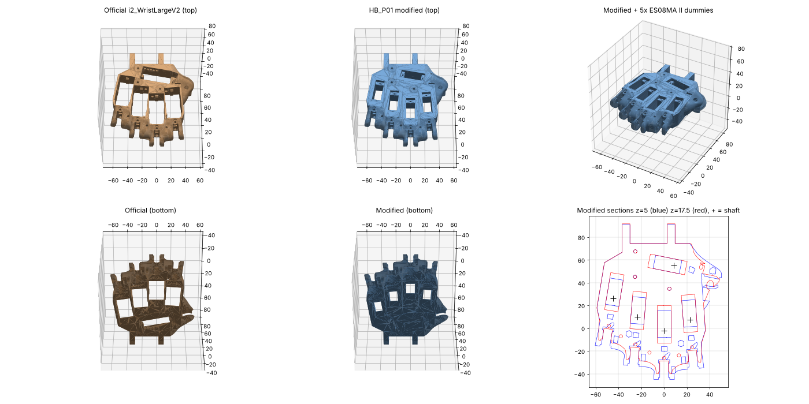

# CAD — HAEBOT Hand i2 V1

All dimensions in mm. Every number is tagged in [`parameters.yaml`](parameters.yaml):
`[SRC]` measured from the official STL · `[DS]` seller nominal · `[EST]` estimate · `[TBM]` to be measured.

> **Status: GENERATED — nothing here has been printed or fit-tested yet.**
> The ES08MA II seat is built from seller-nominal / estimated servo dimensions.
> **Print the fit coupon first**, measure your real servo, update `parameters.yaml`, rebuild.

## Folder map

```
cad/
├── parameters.yaml                  ← single source of truth (edit measured: values here)
├── 01_official_inmoov_i2/           ← UNMODIFIED InMoov files (CC BY-NC 3.0, Gaël Langevin)
│   ├── print/                       ← print these as-is
│   ├── do_not_print/                ← replaced by our parts or not used in V1
│   └── SHA256SUMS.txt               ← checksums of the files as downloaded 2026-11-11
├── 02_haebot_modified/              ← OUR parts (step/ + stl/)
├── 03_one_finger_test/              ← one-finger test rig (step/ + stl/)
├── renders/                         ← automated check renders
└── src/                             ← generators (CadQuery + trimesh/manifold3d)
```

## What happened to the servo mount

The official Hand i2 does **not** hold the finger servos in the palm. It holds them in
**`i2_WristLargeV2`**: five 39.9 × 21.0 mm through-slots for JX PDI-6225MG standard servos,
with a tendon guide above each slot. `[SRC: measured from the STL]`

`HB_P01_WristLarge_ES08MA-II_mod` is that same part with:

1. all 5 JX slots **refilled** (traced from the original slot outline every 0.5 mm, +0.3 mm overlap),
2. a new **ES08MA II seat** cut into each: body slot 23.4 × 11.9, tab ledge at z = 15.5,
   tab recess 32.9 long, 2 × Ø1.8 self-tap pilot holes, and a vertical **cable channel** at the far end,
3. each new output shaft placed on the **same axis as the original JX shaft** (10.1 mm `[EST]` from the
   slot end next to the tendon guide), so the official tendon guides and PTFE paths still line up.

Shaft positions are written to `02_haebot_modified/WristLarge_mod_report.json`.
Palm mounting was evaluated: the official palm/back shells are ~16 mm thick each and have no
tendon routing for 5 palm servos, so V1 keeps the official servo location (documented decision).



## Print list (one right hand + test rig)

Official print settings `[SRC: inmoov.fr/hand-i2]`: 0.25 mm layer max, 30 % infill, 2 mm walls.
If official parts don't fit, InMoov suggests slicer horizontal expansion ≈ −0.15 as a starting point.

### Step 0 — tolerance check (print first)

| # | File | Qty | Supports | Purpose |
|---|---|---|---|---|
| 0a | `01_official_inmoov_i2/print/Calibrator.stl` | 1 | no | Official InMoov printer fit check |
| 0b | `02_haebot_modified/stl/HB_P00_FitCoupon_ES08MA-II.stl` | 1 | no | Drop your ES08MA II in → T-01 |

### Step 1 — one-finger test (before printing the whole hand)

| # | File | Qty | Supports | Notes |
|---|---|---|---|---|
| T01 | `03_one_finger_test/stl/HB_T01_OneFingerRig_Base.stl` | 1 | yes (pin bosses) | Clevis, PTFE/tendon guide tower, servo seat |
| T02 | `03_one_finger_test/stl/HB_T02_OneFingerRig_Washer.stl` | 2 | no | Spacers on the hinge pin either side of the knuckle |
| P03 | `02_haebot_modified/stl/HB_P03_Pulley_ES08MA-II.stl` | 1 | no | Keys onto the stock single-arm horn |
| — | one finger from `i2_FingersX5V2` + its tip from `i2_FingersTipX5V2` | 1 set | per official | Index finger recommended |

Hardware: 1 × ES08MA II, M3 × 25–30 screw or Ø3 mm rod as hinge pin, 2 × M2 self-tap screws (servo tabs),
0.8 mm braided line, PTFE 1.5/2.5 mm tube, elastic cord or 4.8 × 44.5 mm extension spring.


### Step 2 — full hand

| # | File | Qty | Supports | Notes |
|---|---|---|---|---|
| P01 | `02_haebot_modified/stl/HB_P01_WristLarge_ES08MA-II_mod.stl` | 1 | no (as official) | **Replaces** i2_WristLargeV2 |
| P03 | `02_haebot_modified/stl/HB_P03_Pulley_ES08MA-II.stl` | 5 | no | **Replaces** i2_PulleyX5V1 |
| O1 | `01_official_inmoov_i2/print/i2_FingersX5V2.stl` | 1 plate | no | 5 proximal + 4 middle segments |
| O2 | `01_official_inmoov_i2/print/i2_FingersTipX5V2.stl` | 1 plate | yes | Rigid printed fingertips |
| O3 | `01_official_inmoov_i2/print/i2_CoverFingerV3.stl` | 1 | yes | |
| O4 | `01_official_inmoov_i2/print/i2_PalmCoverV2.stl` | 1 | yes | Palm shell (official BOM part) |
| O5 | `01_official_inmoov_i2/print/i2_HandCoverV1.stl` | 1 | yes | Back-of-hand shell (official BOM part) |
| O6 | `01_official_inmoov_i2/print/i2_WristGearV1.stl` | 1 plate | no | Palm ↔ wrist link. No wrist servo in V1 → lock rotation `[verify at assembly]` |

### Do NOT print (kept for reference only)

| File | Why |
|---|---|
| `i2_WristLargeV2.stl` | Replaced by **HB_P01** (JX PDI-6225MG slots) |
| `i2_PulleyX5V1.stl` | Bore fits the JX spline, not the ES08MA II → replaced by **HB_P03** |
| `i2_FingersMoldX5V3.stl` | Mould for silicone tips with Hall-sensor magnets — V1 has no sensors |
| `i2_PalmPDI6225V3.stl`, `i2_HandPDI6225V2.stl` | Alternate palm/back variant, not on the official Hand i2 BOM |
| `i2_Adapter1109MG.stl` | Adapter for a different servo (1109MG) |

Reference-only CAD (never print): `HB_ES08MA-II_reference_dummy` (servo model for assemblies),
`HB_ES08MA-II_pocket_cutter` (the negative used to cut seats — reuse it in your own CAD).

## File formats

| Format | Status |
|---|---|
| **STL** | All parts |
| **STEP (B-rep, parametric source)** | All new parts (P00, P03, T01, T02, dummy, cutter) — clean solids from CadQuery |
| **STEP (faceted)** | `HB_P01_WristLarge_ES08MA-II_mod.step.zip` — the official part is only a mesh, so this STEP is a triangle-faceted solid (106 MB unzipped). It imports as a solid body you can cut/measure, but it has no feature history |
| **Fusion 360 `.f3d`** | **Not included.** An .f3d can only be produced by Fusion 360 itself. To make one: Fusion 360 → *Upload* any `.step` above → *Save*. (We do not ship fake/renamed files) |
| **Editable parametric source** | `src/build_parts.py` (CadQuery, Python) + `parameters.yaml` |

## Rebuild after measuring your servo

```bash
pip install cadquery trimesh manifold3d shapely pyyaml
# 1. edit cad/parameters.yaml  -> fill measured: values (calipers)
python cad/src/build_parts.py           # new parts: STEP + STL
python cad/src/modify_wristlarge.py     # re-cut the official WristLarge
python cad/src/stl_to_step.py cad/02_haebot_modified/stl/HB_P01_WristLarge_ES08MA-II_mod.stl \
                             cad/02_haebot_modified/step/HB_P01_WristLarge_ES08MA-II_mod.step
```

### Caliper checklist (`[TBM]` / `[EST]` → measured)

| Servo (ES08MA II) | Stock single-arm horn |
|---|---|
| body length / width / case height | arm length (shaft centre → tip) |
| tab span, tab thickness | hub diameter + height |
| case bottom → underside of tabs | arm width at hub and at tip |
| tab hole pitch + diameter | arm thickness |
| shaft centre → nearest body end | horn screw diameter |
| shaft height above case, spline Ø | |

## Open risks (from the design review)

- ES08MA II torque (1.6–2.0 kg·cm `[DS]`) is well below the JX PDI-6225MG the hand was designed for.
  Full finger flexion against the return springs is **not verified** — the one-finger rig exists to test this first.
- Ledge height 15.5 assumes the ES08MA shaft top lands near the original JX shaft top (~z 28 `[EST]`).
  If the pulley sits too high/low against the tendon guide, change `derived.es08ma_ledge_z` and rebuild.
- The refill makes the part solid where the JX servos were (84.6 → 146.0 cm³ material).
