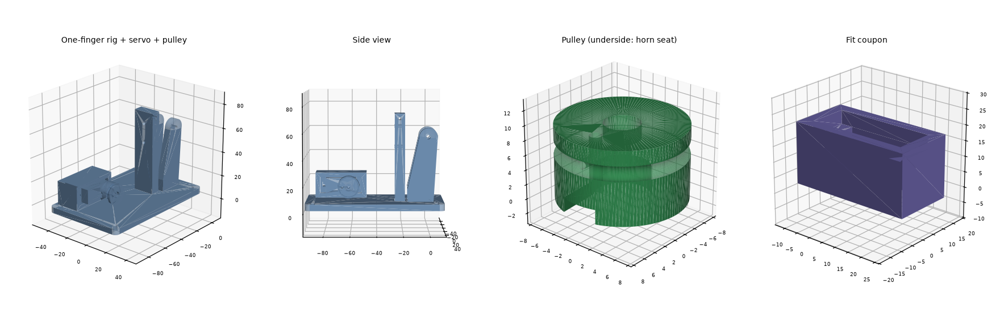

# CAD — HAEBOT Hand i2 V1

All dimensions in mm. Every number is tagged in [`parameters.yaml`](parameters.yaml):
`[SRC]` measured from the official STL · `[DS]` seller nominal · `[EST]` estimate · `[TBM]` to be measured.

> **Status: GENERATED — nothing here has been printed or fit-tested yet.**
> ES08MA II geometry comes from seller-nominal / estimated dimensions.
> **Print the fit coupon first**, measure your real servo, update `parameters.yaml`, rebuild.

## Folder map

```
cad/
├── parameters.yaml                  ← single source of truth (edit measured: values here)
├── 01_official_inmoov_i2/           ← UNMODIFIED InMoov Hand i2 files (CC BY-NC 3.0, Gaël Langevin)
│   ├── print/                       ← print these as-is
│   ├── do_not_print/                ← not used in V1
│   └── SHA256SUMS.txt               ← checksums of the files as downloaded 2026-11-11
├── 02_haebot_modified/              ← OUR parts (step/ + stl/)
├── 03_one_finger_test/              ← one-finger test rig (step/ + stl/)
├── renders/
└── src/build_parts.py               ← CadQuery generator for all our parts
```

## Where the finger servos go

In the official design the 5 finger servos sit in the **forearm**, on the InMoov
**Simple Servo Bed** (inside `Robpart5`, with `RobCableFront` / `RobCableBack`).
The finger lines run from the hand to the servos through PTFE tubes
(thumb 335, index/middle/ring 300, pinky 360 mm) `[SRC: inmoov.fr/hand-i2]`.

**Next step (not done yet):** download the official *Forearm-and-Servo-Bed* set and make an
ES08MA II version of the Simple Servo Bed. Until then, no hand part is modified.

## Print list

Official print settings `[SRC: inmoov.fr/hand-i2]`: 0.25 mm layer max, 30 % infill, 2 mm walls.
If official parts don't fit, InMoov suggests slicer horizontal expansion ≈ −0.15 as a starting point.

### Step 0 — tolerance check (print first)

| # | File | Qty | Supports | Purpose |
|---|---|---|---|---|
| 0a | `01_official_inmoov_i2/print/Calibrator.stl` | 1 | no | Official InMoov printer fit check |
| 0b | `02_haebot_modified/stl/HB_P00_FitCoupon_ES08MA-II.stl` | 1 | no | Drop your ES08MA II in → T-01 |

### Step 1 — one-finger test (before printing the whole hand)

| # | File | Qty | Supports | Notes |
|---|---|---|---|---|
| T01 | `03_one_finger_test/stl/HB_T01_OneFingerRig_Base.stl` | 1 | yes (pin bosses) | Clevis, PTFE/tendon guide tower, ES08MA II seat |
| T02 | `03_one_finger_test/stl/HB_T02_OneFingerRig_Washer.stl` | 2 | no | Spacers on the hinge pin either side of the knuckle |
| P03 | `02_haebot_modified/stl/HB_P03_Pulley_ES08MA-II.stl` | 1 | no | Keys onto the stock single-arm horn |
| — | one finger from `i2_FingersX5V2` + its tip from `i2_FingersTipX5V2` | 1 set | per official | Index finger recommended |

Hardware: 1 × ES08MA II, M3 × 25–30 screw or Ø3 mm rod as hinge pin, 2 × M2 self-tap screws (servo tabs),
0.8 mm braided line, PTFE 1.5/2.5 mm tube, elastic cord or 4.8 × 44.5 mm extension spring.



### Step 2 — hand (official parts, unmodified)

| # | File | Qty | Supports | Notes |
|---|---|---|---|---|
| O1 | `01_official_inmoov_i2/print/i2_FingersX5V2.stl` | 1 plate | no | 5 proximal + 4 middle segments |
| O2 | `01_official_inmoov_i2/print/i2_FingersTipX5V2.stl` | 1 plate | yes | Rigid printed fingertips |
| O3 | `01_official_inmoov_i2/print/i2_CoverFingerV3.stl` | 1 | yes | |
| O4 | `01_official_inmoov_i2/print/i2_PalmCoverV2.stl` | 1 | yes | Palm shell (official BOM part) |
| O5 | `01_official_inmoov_i2/print/i2_HandCoverV1.stl` | 1 | yes | Back-of-hand shell (official BOM part) |
| O6 | `01_official_inmoov_i2/print/i2_WristLargeV2.stl` | 1 | no | Wrist piece, bolts to RotaWrist3 |
| O7 | `01_official_inmoov_i2/print/i2_WristGearV1.stl` | 1 plate | no | Wrist rotation gear |
| P03 | `02_haebot_modified/stl/HB_P03_Pulley_ES08MA-II.stl` | 5 | no | On the ES08MA II servos, replaces i2_PulleyX5V1 |

Forearm / servo-bed parts: **not included yet** (see "Where the finger servos go").

### Do NOT print (kept for reference only)

| File | Why |
|---|---|
| `i2_PulleyX5V1.stl` | Bore fits the JX-6225MG spline, not the ES08MA II → use **HB_P03** |
| `i2_FingersMoldX5V3.stl` | Mould for silicone tips with Hall-sensor magnets — V1 has no sensors |
| `i2_PalmPDI6225V3.stl`, `i2_HandPDI6225V2.stl` | Alternate palm/back variant, not on the official Hand i2 BOM |
| `i2_Adapter1109MG.stl` | Adapter for a different servo (1109MG) |

Reference-only CAD (never print): `HB_ES08MA-II_reference_dummy` (servo model for assemblies),
`HB_ES08MA-II_pocket_cutter` (negative used to cut an ES08MA II seat — reuse it in your own CAD).

## File formats

| Format | Status |
|---|---|
| **STL** | All parts |
| **STEP (B-rep)** | All our parts — clean solids generated by CadQuery |
| **Fusion 360 `.f3d`** | **Not included.** Only Fusion 360 can create one: Fusion 360 → *Upload* a `.step` → *Save* |
| **Editable parametric source** | `src/build_parts.py` + `parameters.yaml` |

## Rebuild after measuring your servo

```bash
pip install cadquery pyyaml
# edit cad/parameters.yaml -> fill measured: values (calipers)
python cad/src/build_parts.py
```

### Caliper checklist (`[TBM]` / `[EST]` → measured)

| Servo (ES08MA II) | Stock single-arm horn |
|---|---|
| body length / width / case height | arm length (shaft centre → tip) |
| tab span, tab thickness | hub diameter + height |
| case bottom → underside of tabs | arm width at hub and at tip |
| tab hole pitch + diameter | arm thickness |
| shaft centre → nearest body end | horn screw diameter |
| shaft height above case, spline Ø | |

## Open risks

- ES08MA II torque (1.6–2.0 kg·cm `[DS]`) is far below the servos the InMoov forearm bed was designed for
  (MG946R / HK15298 class), and the line runs through 300–360 mm of PTFE tube (friction).
  Full finger flexion is **not verified** — the one-finger rig exists to test this first.
