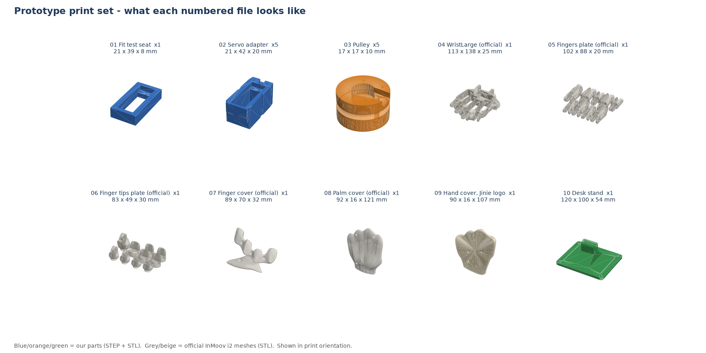
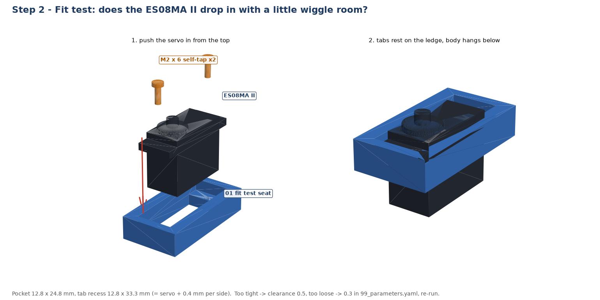
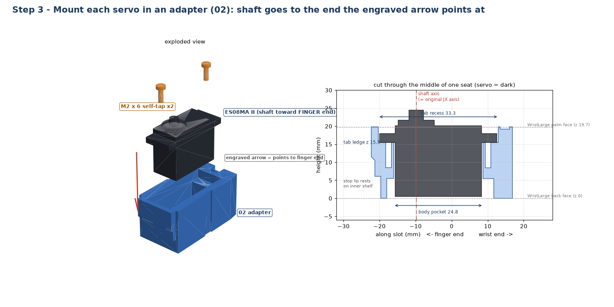
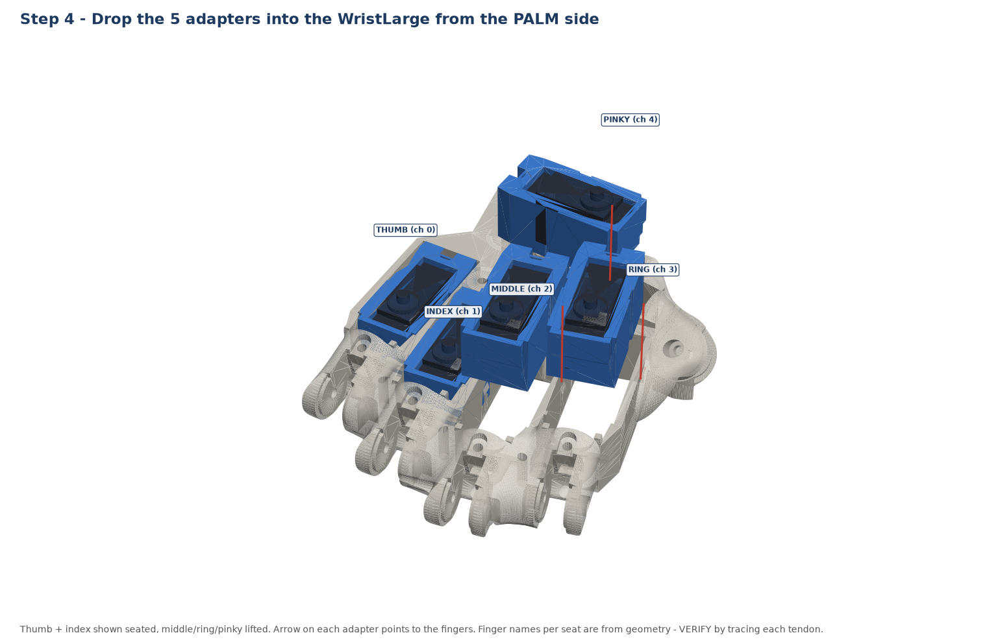
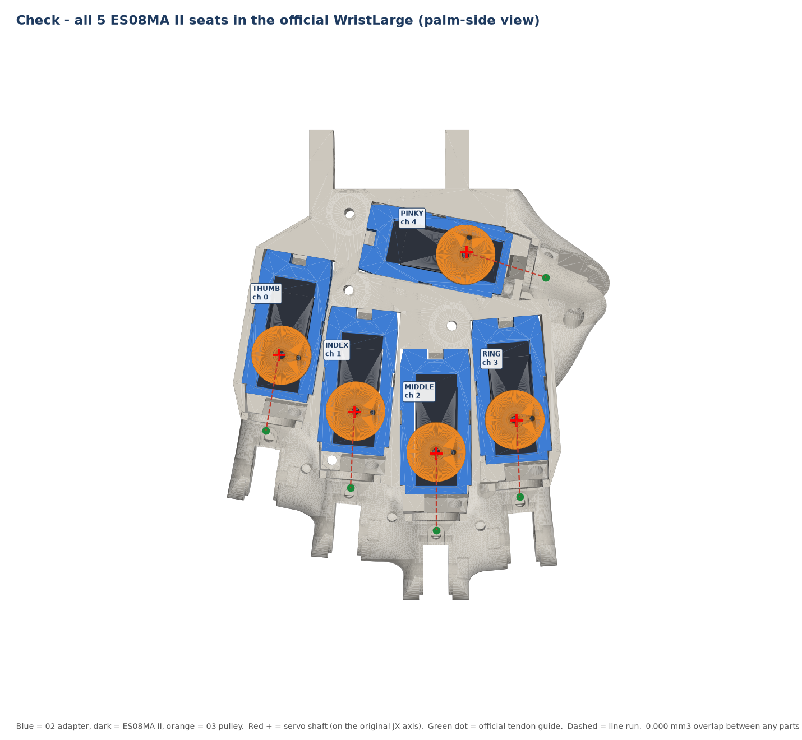
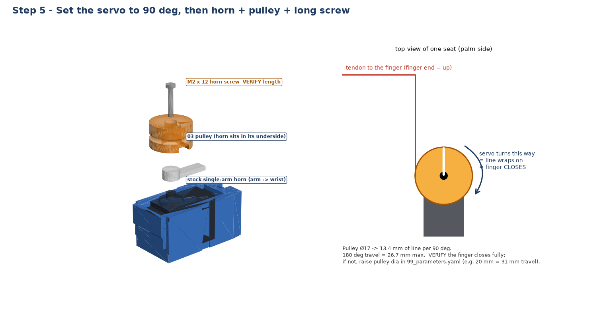
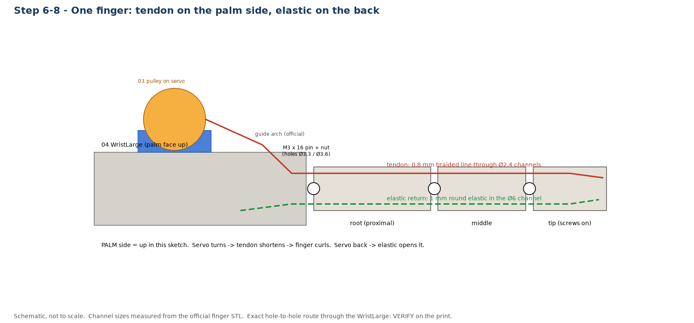
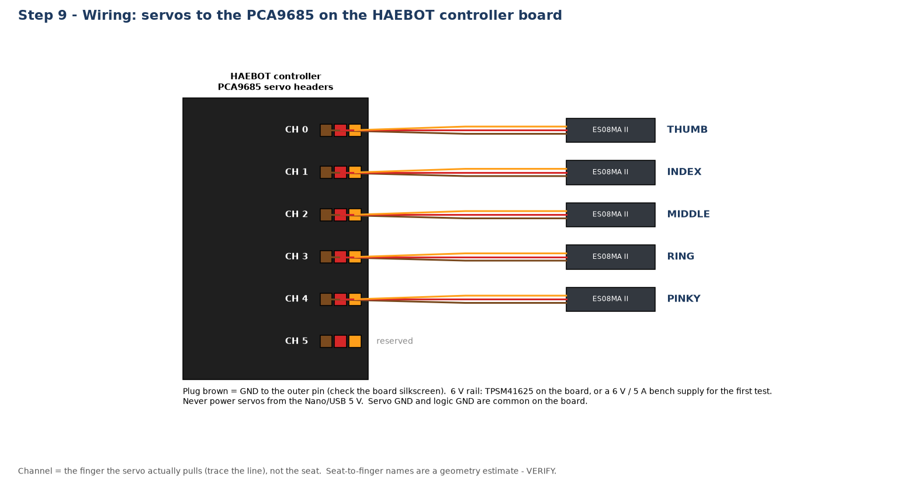
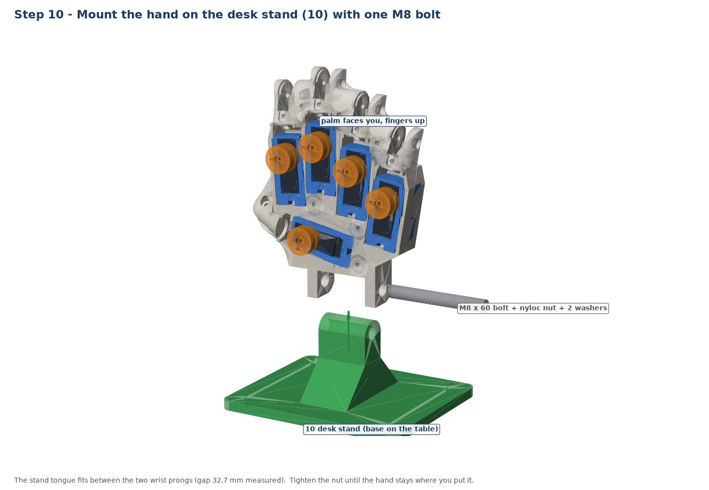

# Assembly guide — HAEBOT Hand prototype (InMoov i2 + EMAX ES08MA II)

This guide is complete on its own. Part numbers match the file names in this folder (`02` = `02_ServoAdapter_ES08MA-II_x5.stl`).
Anything marked **VERIFY** has not been checked on a real print yet. Check it while you build and tell us what you find.

## How the design works (read once)

- The official **WristLarge (04)** is the palm frame. It has **5 big slots**, one per finger. They were made for big 40 × 20 mm servos, so the
  EMAX ES08MA II (about 23–24 × 12 mm) falls through. That is why your servo did not fit.
- InMoov's own fix for small servos is an **adapter that drops into each slot**. **02** is that adapter, made for the ES08MA II with
  **0.4 mm wiggle room per side**. You do **not** reprint the WristLarge. The one you already printed is used as it is.
- Each servo sits upright in its adapter. The **shaft points to the palm side** and sits at the **finger end** of the slot, in the same place as the
  original big servo's shaft. A **pulley (03)** on the shaft winds the finger's **tendon** (braided fishing line). When the servo turns, the finger closes.
  A **round elastic** on the back of each finger opens it again (InMoov's recommendation for small servos instead of springs).
- For the prototype the hand stands on a **desk stand (10)** instead of a forearm, so there is no wrist rotation yet.



## 1. Tools and hardware

**Tools:** calipers, small Phillips screwdrivers (PH0, PH1), 3.0 mm drill bit (by hand or in a pin vise), 1.5–2 mm drill bit, M3 tap (optional),
sharp hobby knife, flush cutters, needle-nose pliers, a needle or thin wire to thread line, superglue (CA), lighter, servo tester **or** the controller
board with the test sketch.

| Item | Qty | Size / spec | Where it goes | How we know the size |
|---|---|---|---|---|
| EMAX ES08MA II servo | 5 (+1 spare) | — | finger servos | you own them |
| Self-tapping screw, pan head | 10 (+4) | **M2 × 6** (servo bags often include them) | servo tabs into **02** | pilot holes in 02 are Ø1.6 mm, made for M2 |
| Horn screw, pan head | 5 | **M2 × 12** — VERIFY thread and length on your servo | through **03** into the servo spline | 03 has a Ø2.2 mm hole, 10 mm tall, head pocket 2 mm deep |
| Countersunk screw + nut | about 25 (+5) | **M3 × 16** and **M3 nuts** | finger hinges, finger to palm, covers | finger hinge holes measure **Ø3.3 / Ø3.6 mm** (05, 06, 04) with **Ø6.0–6.3 mm** nut/head pockets; cover holes **Ø2.9 mm** (screw cuts its own thread). Count VERIFY |
| Braided fishing line | 3 m | **0.8 mm, 200 lb** braid (PE) | tendons | finger tendon channels measure **Ø2.2–2.5 mm** |
| Round elastic cord | 2 m | **1.0 mm** (jewelry/beading elastic) | finger return | spring channel in the fingers measures **Ø6.0 mm** |
| Steel pin | 5–10 short pieces | **≤ 0.9 mm** (cut sewing needle or paperclip wire) | elastic anchor across the finger | small cross holes measure **Ø1.0 mm** |
| Short screw | 5 | **M3 × 4** | elastic anchor at the palm end | official spring-anchor holes, Ø2.9 mm |
| Hex bolt + nyloc nut + 2 washers | 1 set | **M8 × 60** | hand to desk stand | wrist prong holes measure **Ø8.3 mm**, prongs 6.9 mm thick, gap 32.7 mm |
| Screws for the stand base | 4 | M4 wood screws (optional) | stand to a board | holes Ø4.4 mm |
| Zip ties, small | 5 | 2.5 mm | servo cables | — |
| 6 V power | 1 | the HAEBOT board 6 V servo rail, **or** a 6 V / 5 A bench supply for the first test | servos | 5 × ES08MA II stall ≈ 5.5 A total (see `electronics/version_1/power_budget.md`) |

**Not needed for this prototype:** PTFE tube (only for servos in the forearm), springs, Hall sensors, magnets, silicone, ribbon cable.

## 2. Print the fit test (01) and check the servo



1. Print **01** (about 10 minutes, no supports).
2. Push one ES08MA II in from the top. The **tabs should rest on the ledge** and the body should hang through. It should go in by hand without forcing,
   with a little play (about 0.4 mm each side).
3. Put in the two **M2 × 6** screws through the tab holes. They should bite into the plastic.
4. Decide:
   - **Too tight** → in `99_parameters.yaml` set `clearance: 0.5`. **Too loose** → `clearance: 0.3`. Then run `python 99_build_prototype.py` and print 01 again.
   - **Screws miss the holes** → measure the distance between the two tab-hole centres and put it in `tab_hole_pitch` (now 27.6). Rebuild. (See open question Q1.)
   - **OK** → print the five **02** adapters and five **03** pulleys.

## 3. Clean up the prints

1. Remove all supports from 06, 07, 08, 09. Clean the edges with a knife.
2. Run a **3.0 mm drill** by hand through every finger hinge hole (05, 06 and the finger hinge holes on 04) so an M3 screw slides through freely.
   Joints must move **smoothly with no friction**. This matters more than anything else.
3. Run a **2.0 mm drill** or a needle through each finger's tendon channel. A needle must pass from the root to the tip.
4. Clear the **6 mm elastic channel** on the back of each finger segment.
5. On **04**, clear the tendon openings at the finger end of each servo slot and the guide arches on the palm face (look at img_06 for where they are).

## 4. Mount each servo in an adapter (02)



1. Look at the top of the adapter: the **engraved arrow points to the finger end**.
2. Turn the servo so its **shaft is at the arrow end** and the **lead (wire) exits at the bottom**. There is a cable notch at the bottom of both ends; use
   whichever end your servo's wire comes out of.
3. Push the servo in until the tabs sit on the ledge. Fix it with **2 × M2 × 6** screws. Do not overtighten; the plastic is thin around the screw (0.6 mm to the pocket).
4. Repeat for all 5. Write the finger name on each adapter with a marker after step 5.

## 5. Put the adapters into the WristLarge (04)



1. Hold 04 with the **palm side up** (the side with the small guide arches near the finger joints).
2. Drop each adapter into a slot from the palm side, **arrow toward the fingers**. It slides in until a small lip at the finger end stops on
   a shelf inside the WristLarge. Run the servo wire down through the slot to the back side.
3. The adapter is a slip fit, like InMoov's own adapter. If one is loose, put **one drop of CA glue** at two corners. Don't glue until step 9 has worked.
4. Seat names we expect (from the geometry; **VERIFY** in step 7 by pulling each line):

| Seat | Slot | PCA9685 channel |
|---|---|---|
| THUMB | outer slot on the thumb side | 0 |
| INDEX | next slot | 1 |
| MIDDLE | centre slot (closest to the fingers) | 2 |
| RING | slot on the little-finger side | 3 |
| PINKY | slot lying across the palm near the wrist | 4 |



## 6. Center each servo, then fit horn and pulley (03)



1. Connect one servo at a time to the servo tester or the board (step 9 wiring) and send **90°**. Unplug it.
2. Press the **stock single-arm horn** onto the shaft with the arm pointing to the **wrist end** (the arm sits inside the pulley pocket, so its
   direction only sets the starting point).
3. Press the **pulley (03)** over the horn (the pocket on its underside matches the horn) and screw it down with the **M2 × 12** screw through the centre.
   If the horn does not fit the pocket, measure your horn and enter it under `pulley: horn:` in `99_parameters.yaml`, then rebuild (**VERIFY** with your horn).
4. Line travel: the Ø17 pulley pulls **13.4 mm per 90°** and **26.7 mm** over the full 180°. **VERIFY** that is enough to close a finger fully (step 8).
   If not, raise `pulley: dia` (20 mm → 31 mm of travel, but less pulling force) and rebuild.

## 7. Assemble the fingers and thread the tendons



1. Lay out the segments from 05 and the tips from 06. Every finger has the same shape except the thumb. Don't fit a finger upside down: the
   **tendon channel is on the palm side** and the **6 mm elastic channel is on the back**.
2. Join the segments with **M3 × 16** screws and nuts. Tighten until there is no wobble, then back off until the joint swings freely under its own weight.
3. **Tendon:** cut 5 × **50 cm** of 0.8 mm braid. Put CA on the last 1 cm, let it dry and cut it at an angle. That gives a stiff needle tip.
   Thread it from the **tip down through the finger** to the root. Tie a knot at the tip end and pull it into the V-groove of the tip, then screw the tip on.
4. Fix each finger to the finger end of 04 with **M3 × 16** screw and nut through the root hinge. Order: middle, index, ring, pinky, thumb.
5. Route each tendon from the finger root through the opening in 04 and under the **guide arch** to **its servo's pulley**. The line should leave
   the arch almost level with the pulley groove (groove height is 25 mm above the back face of 04). **VERIFY** the exact hole route on your print;
   it may rub on an edge. If it does, round the edge with a knife.
6. Now check which servo each finger reaches. If it is different from the table in step 5, write the real finger on the adapter. The **finger** decides the channel.

## 8. Tension the tendons and fit the elastics

1. **Elastic:** cut 5 × 25 cm of 1 mm elastic. Push it through the **6 mm channel** on the back of each finger. Lock it at the tip end with a
   short pin through the **Ø1.0 mm** cross hole and a drop of CA. At the palm end, tie it around an **M3 × 4** screw in the spring-anchor hole on 04.
   Pull it so the finger **opens straight by itself** but bends easily by hand. Thumb: lighter tension.
2. **Tendon:** with the finger **open** and the servo at its **open end**, pass the line through the pulley's **radial hole** in the groove, take
   **one full turn** around the groove in the closing direction (img_05), then through the **tie-off hole**, knot it and add a drop of CA.
   The line should be just tight with the finger fully open. *(Open end = 0° or 180°, whichever turns the pulley away from the closing direction.
   Choose it per servo with the tester and note it for the firmware.)*
3. Move the servo slowly to the other end. The finger should close fully without the servo buzzing hard at the end. If it stalls, shorten the travel in
   the firmware. If it doesn't close fully, see step 6.4.

## 9. Wiring and first power-up



1. Route the 5 servo wires along the back of 04 to the wrist and bundle them with a zip tie. Leave enough slack so nothing pulls when the fingers move.
2. Plug each servo into the **PCA9685** header on the controller board: **CH0 thumb, CH1 index, CH2 middle, CH3 ring, CH4 pinky**, CH5 is kept for the
   wrist later. **Brown = GND, red = 6 V, orange = signal.** Check the pin order on the board silkscreen.
3. Servo power comes from the **6 V rail** (board) or a **6 V / 5 A bench supply** with its current limit at about 3 A for the first test.
   **Never** power the servos from USB or the Nano's 5 V. All grounds are common.
4. First test, **one finger at a time**: send the open position, then move in 10° steps to closed and back. Watch for rubbing lines, a hot servo or an
   adapter moving. Then test all five, then Rock / Paper / Scissors.
5. If a servo gets hot or buzzes when held closed, reduce its closed angle by 5–10°. The ES08MA II is small (about 1.6–2.0 kg·cm), so the grip is light.

## 10. Covers and stand



1. When all 5 fingers work, fit the **palm cover (08)** with 3 × M3 × 16. Lay the lines in their paths and don't pinch them. Then fit the **Jinie hand cover (09)**
   on the back and the **finger cover (07)** with M3 × 16 screws (holes Ø2.9 mm: the screw cuts its own thread).
   **VERIFY:** the pulleys stand 11 mm above the palm face (top at 30.5 mm above the back face). Check that 08 closes without touching them. If it
   touches, tell us; the pulley can be made lower.
2. Slide the **desk stand (10)** tongue between the two wrist prongs of 04, put in the **M8 × 60** bolt with a washer each side and the nyloc nut.
   Tighten until the hand stays where you put it. The palm faces forward and the fingers point up.

## Open points (VERIFY list)

| # | What | How to check |
|---|---|---|
| Q1 | Your EMAX drawing says **27.6 mm** for the tabs. We read it as the **distance between the two tab holes** (EMAX lists the servo as 32.5 mm long with tabs). If 27.6 is really the overall tab length, the screws will miss the holes. | Measure on the servo, test on 01 |
| Q2 | Shaft position on the body (5.9 mm from the end, taken from the generic drawing), tab thickness (2.5 mm), which end the wire leaves the body | Calipers on the servo; 01 fit test |
| Q3 | Which seat drives which finger (step 5 table) and the exact tendon route through 04 | Step 7.6 |
| Q4 | Line travel: is 26.7 mm (Ø17 pulley, 180°) enough to close a finger? Official build used 300° servos. | Step 8.3 |
| Q5 | Palm cover (08) clearance over the pulleys | Step 10.1 |
| Q6 | Number of M3 × 16 screws | Count the holes when assembling |
| Q7 | Horn shape and horn screw | Measure; update `pulley: horn:` |

## Rebuild after measuring

```bash
pip install cadquery trimesh manifold3d shapely matplotlib pyyaml
# edit 99_parameters.yaml (calipers), then:
python 99_build_prototype.py
```
This rebuilds 01, 02, 03 and 10 (STL + STEP), re-checks every seat against the official WristLarge (`99_check_report.json`) and redraws the `img_` pictures.

Mechanical base: InMoov Hand i2 © Gaël Langevin, CC BY-NC 3.0 (non-commercial). See `../../ATTRIBUTION.md`.
