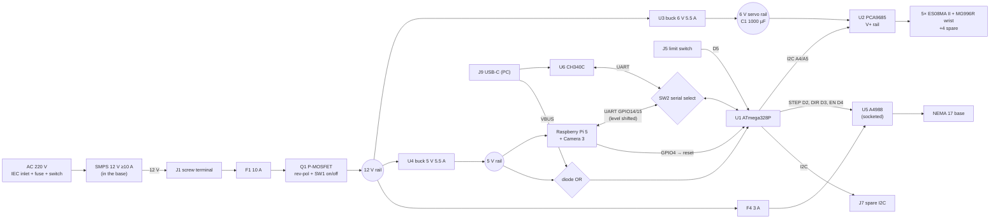
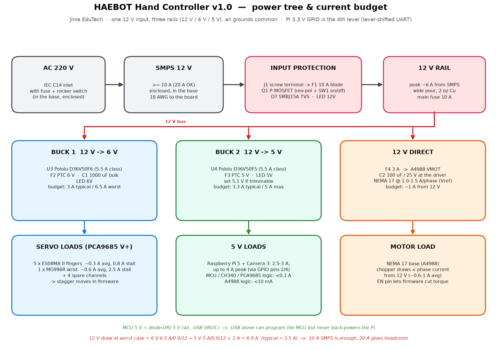

# HAEBOT Hand Controller v1.0 — electronics concept

Jinie EduTech · custom controller board for the robot hand (5 fingers + wrist + NEMA 17 base).
Status: **concept / pre-schematic.** The placement and drawings show what goes where and why. Nothing here is routed yet. The next step is the KiCad schematic.

| | |
|---|---|
| Board | **115 × 56 mm**, 2-layer, 1.6 mm, **2 oz copper**, black solder mask, white silkscreen, ENIG |
| Raspberry Pi 5 | stacks on top of the right-hand 85 mm, on 4 × M2.5 × 18 mm standoffs (Pi hole pattern 58 × 49 mm) |
| Open zone | left 30 mm, not covered by the Pi: power entry, fuse, servo headers, A4988, logo |
| Input | one 12 V supply (SMPS ≥ 10 A, 20 A OK) |
| Rails | 12 V (stepper) · 6 V 5.5 A (servos) · 5 V 5.5 A (Pi + logic) |
| Brain | ATmega328P + CH340C + USB-C on board (works like a Nano) |
| Servo driver | PCA9685 on board, 10 outputs (6 used + 4 spare) |
| Stepper | A4988 StepStick in a socket (TMC2209 drop-in later) |

## Renders and drawings

| File | What it shows |
|---|---|
| `renders/layout_top.png` | to-scale top-view layout on a mm grid, with the Pi outline dashed, connectors on the edges and the logo |
| `renders/power_tree.png` | power tree and current budget |
| `renders/3d_top.png` | 3D top view without the Pi |
| `renders/3d_iso_no_pi.png` | 3D isometric view without the Pi |
| `renders/3d_iso_with_pi.png` | 3D isometric view with the Pi 5 stacked on standoffs and the PI-LINK cable |
| `HAEBOT_HandController_v1_concept.step` | 3D model of the board (silkscreen text left out to keep the file small) |
| `HAEBOT_HandController_v1_concept_STEP_full.zip` | full-detail STEP files: the board with silkscreen, and the board with the Pi 5 |
| `bom_controller_v1.csv` | draft BOM. An LCSC number is filled in only where it was checked on lcsc.com / jlcpcb.com |
| `concept/` | `layout.py` holds every coordinate in one place. `draw_2d.py` makes the 2D PNGs and `model_3d.py` makes the STEP files and 3D renders (CadQuery) |

To regenerate the outputs, run `python concept/draw_2d.py` and `python concept/model_3d.py`. You need CadQuery 2.x and matplotlib.

## Block diagram

## Power tree and current budget

| Rail | Source | Loads | Typical | Worst case | Protection |
|---|---|---|---|---|---|
| 12 V | SMPS via J1 → F1 → Q1 | U3, U4, A4988 VMOT | ~3.5 A | ~6.9 A | F1 10 A blade, D7 SMBJ15A TVS, Q1 reverse polarity |
| 12 V motor | 12 V → F4 | A4988 + NEMA 17 (1.0–1.5 A/phase set by Vref) | 0.6–1 A | ~1.5 A | F4 3 A, C2 100 µF at the driver |
| 6 V | U3 Pololu D36V50F6 | PCA9685 V+: 5 × ES08MA II (≈0.3 A avg, ≈0.8 A stall), MG996R wrist (≈0.6 A avg, ≈2.5 A stall) | ~3 A | ~6.5 A if everything stalls at once | F2 7 A, C1 1000 µF |
| 5 V | U4 Pololu D36V50F5 | Pi 5 + Camera 3 (2.5–3 A, ~4 A peak), MCU/CH340/PCA9685 logic < 0.1 A | ~3.3 A | ~5 A | F3 5 A |
| MCU 5 V | diode-OR of the 5 V rail and USB VBUS | ATmega328P, CH340C, PCA9685 VCC, A4988 VDD | < 0.1 A | | USB on its own can program the MCU but never back-powers the Pi |

12 V worst case ≈ 6 V·6.5 A/0.9/12 + 5 V·5 A/0.9/12 + 1 A ≈ **6.9 A**, so a 10 A SMPS is enough and 20 A gives headroom. A large SMPS will also push a lot of current into a short, which is why every rail has its own fuse. Run 18 AWG or thicker wire from the SMPS and keep the 12 V input copper pour wide.

## MCU pin map (ATmega328P, Arduino Nano numbering)

| Pin | Function | Direction | Notes |
|---|---|---|---|
| D0 / RXD | serial RX | in | SW2 picks the source: CH340 TX, or Pi TXD through U7 74AHCT1G125 |
| D1 / TXD | serial TX | out | SW2 picks the destination: CH340 RX, or Pi RXD through a 1 k / 2 k divider (5 V → 3.3 V) |
| D2 | A4988 STEP | out | AccelStepper `run()` every loop, no `delay()` |
| D3 | A4988 DIR | out | |
| D4 | A4988 /ENABLE | out | 10 k pull-up keeps the driver off at boot |
| D5 | base limit switch | in | INPUT_PULLUP, switch to GND (J5) |
| D6 | spare (PWM) | – | test pad |
| D7 | PCA9685 /OE | out | 10 k pull-up keeps the servos off until the firmware has set safe angles |
| D8 | spare | – | test pad |
| D9, D10 | spare (PWM) | – | test pads |
| D11 / D12 / D13 | MOSI / MISO / SCK | – | J8 ICSP. D13 also drives the STAT LED (D4), like a Nano |
| A0 | 12 V sense | in | 47 k / 10 k divider |
| A1 | 6 V servo-rail sense | in | 10 k / 10 k divider |
| A2, A3 | spare | – | test pads |
| A4 / A5 | I2C SDA / SCL | i/o | PCA9685 (0x40) + J7, 4.7 k pull-ups to 5 V |
| A6, A7 | spare (analog only) | – | |
| RESET | reset | in | SW3, CH340 DTR via 100 nF (auto-reset), and Pi GPIO4 via Q2 2N7002 |

PCA9685 channels: CH0 THUMB · CH1 INDEX · CH2 MIDDLE · CH3 RING · CH4 PINKY · CH5 WRIST · CH6–CH9 spare (SP1–SP4). CH10–CH15 have no headers and are left free for v2.
A4988 micro-step: JP1 has MS1–MS3 under the driver, the same as a CNC shield. All three jumpers on gives 1/16 step, the default.

## Connectors

| Ref | Connector | Edge / zone | Pins |
|---|---|---|---|
| J1 | 2P 5.08 mm screw terminal | left edge, open zone | +12 V, GND |
| F1 | ATM mini-blade fuse holder | open zone | 10 A |
| J10 | 3 × 10 male header 2.54 mm (vertical) | open zone | S / V+ (6 V) / G for CH0–CH9 |
| U5 | 2 × 1×8 female sockets (StepStick) | open zone | A4988 / TMC2209 module |
| J4 | JST-XH 4P side-entry | top edge, under the Pi | A+ A− B+ B− (NEMA 17) |
| J5 | JST-XH 3P side-entry | top edge, under the Pi | 5 V, SIG (D5), GND |
| J6 | JST-XH 7P side-entry | top edge, under the Pi | 5 V, 5 V, GND, GND, TX→Pi, RX←Pi, RST |
| J7 | JST-XH 4P side-entry | top edge, under the Pi | 5 V, SDA, SCL, GND (5 V I2C, not Qwiic 3.3 V) |
| J9 | USB-C | right edge, under the Pi's USB ports | USB 2.0 to the CH340 |
| SW1 | slide switch (right-angle) | bottom edge | board on/off (switches Q1's gate) |
| SW2 | DPDT slide switch (right-angle) | right edge | MCU UART ↔ USB or Pi |
| SW3 | tact switch (right-angle) | right edge | reset |
| D1–D6 | side-view LEDs | bottom edge | 12V · 6V · 5V · STAT · TX · RX |
| J8 | 2 × 3 ICSP | under the Pi | bootloader programming (lift the Pi off first) |

Every part under the Pi is **12 mm tall or less** (the buck modules are the tallest), which leaves about 6 mm of air gap with 18 mm standoffs. Connectors under the Pi are **side-entry**, so cables plug in sideways. Tall, hot and hands-on parts sit in the open zone: the A4988 with its heatsink is about 20 mm tall, along with the servo headers and the fuse.

## Raspberry Pi 5 integration

**How the Pi connects (concept change):** a 40-pin stacking header does not work with the Pi on top. The Pi 5's GPIO header has its pins on the Pi's top side, facing away from our board, so a header on our board has nothing to plug into. The board uses the SKR-Pico approach instead:

- **J6 PI-LINK** (XH-7) runs a short cable of about 80 mm, 22 AWG, around the board edge to a **2×5 Dupont housing on Pi pins 1–10**:

| Pi pin | Signal | Wire |
|---|---|---|
| 2, 4 | 5 V | 2 wires (5 V into the Pi) |
| 6, 9 | GND | 2 wires |
| 8 | GPIO14 TXD | → MCU RX (through the U7 buffer) |
| 10 | GPIO15 RXD | ← MCU TX (through the divider) |
| 7 | GPIO4 | → Q2 → MCU RESET, so the Pi can flash the MCU (`avrdude -c arduino` + GPIO reset) |
| 1, 3, 5 | 3V3, SDA, SCL | **left empty** (never connect our 5 V to pin 1) |

- The alternatives were rejected. Pogo pins on the solder tails under the Pi are fragile for a classroom. Mounting the Pi upside down puts the camera and ports in the wrong place. Putting our board on top as a HAT is not what was agreed.

**Back-powering the Pi through the GPIO 5 V pins: caveats**
1. It **bypasses the Pi's own USB-C input protection**, so U4 and F3 have to be clean and stable. U4 is a regulated module with output over-voltage protection.
2. A Pi powered this way cannot negotiate 5 A over USB-PD, so it assumes a 3 A supply and **limits its USB ports to 600 mA total**. The Camera 3 uses the ribbon cable and is not affected. If the 5 V rail really can supply 5 A, tell the Pi so:
   - in `/boot/firmware/config.txt`, add `usb_max_current_enable=1` (this also silences the "power supply" warning), and
   - optionally set `PSU_MAX_CURRENT=5000` with `sudo rpi-eeprom-config --edit`.
3. **Never plug the Pi's own USB-C supply in at the same time.** Two supplies in parallel would fight each other.
4. 2 × 5 V and 2 × GND Dupont contacts at about 3 A each carry up to about 5 A. Keep the cable short.
5. UART: enable it with `dtparam=uart0=on` in `config.txt` (it appears as `/dev/ttyAMA0` on a Pi 5) and turn off the serial login console in `raspi-config`.

**Serial select (SW2):** set it to USB to program or debug from a PC over USB-C, and to Pi to run. Since the Pi can also flash the MCU over PI-LINK, the switch mostly stays on Pi.

## Heat

- Each buck module loses roughly 2–3 W at full load (about 90 % efficient), and both sit under the Pi. Keep the 18 mm air gap, put vents in the case on both long sides, and preferably add a small 5 V fan in the base blowing across the board. The Pi 5 Active Cooler pulls air from above, so it doesn't cool our board.
- The A4988 sits in the open zone with its heatsink. Set Vref for 1.0–1.2 A per phase, and use the EN pin (D4) to switch the motor off when the base is idle.
- Use 2 oz copper with wide pours for 12 V, 6 V and GND, plus thermal vias under the module pads.

## Feasibility notes and risks

1. **The 40-pin stacking header is replaced by the PI-LINK cable** (see above). This is the only change from the agreed spec.
2. **Servo peak current:** the worst case, with every servo stalled, is about 6.5 A, more than the 5.5 A class buck. The firmware should stagger moves and ease toward targets, and C1 absorbs the spikes. If an elbow (DS5160) is added later, change U3 to a 6 V regulator from the higher-current Pololu D42V110Fx family (same form-factor class, about 2× the current) or move to the v2 integrated buck.
3. **Fit:** everything fits on 115 × 56 mm with the Pi's footprint over the right 85 mm. The Pi 5's USB and Ethernet jacks overhang its PCB by about 2 mm at the x = 115 end, which is fine for a case.
4. **Pi side clearance:** the side-entry connectors under the Pi have about 18 mm of room for fingers and plugs. Label them on the case.
5. **5 V for the Pi:** the D36V50F5 is fixed at 5.0 V. Pi 5 under-voltage warnings start around 4.63 V, so keep the PI-LINK cable short and thick. In v2, set the integrated buck to 5.1 V.

## v1 vs v2

| | v1 (this concept, prototype / grant demo) | v2 (classroom kit) |
|---|---|---|
| Buck converters | solder-on Pololu D36V50F6 / F5 modules (proven, about US$40 each) | integrated TPS56637-class 6 A synchronous bucks (6 V and 5.1 V), copying the datasheet layout, assembled by JLCPCB |
| Stepper driver | A4988 StepStick in a socket | same socket. A TMC2209 option gives quiet motion |
| Pi link | XH-7 cable to pins 1–10 | same, with a moulded keyed cable |
| Board size | 115 × 56 mm | same footprint (case stays compatible) |
| Cost driver | the modules | PCBA parts count |
| Extras | – | INA219 current monitor on the servo rail, fan header, CH10–CH15 headers |
